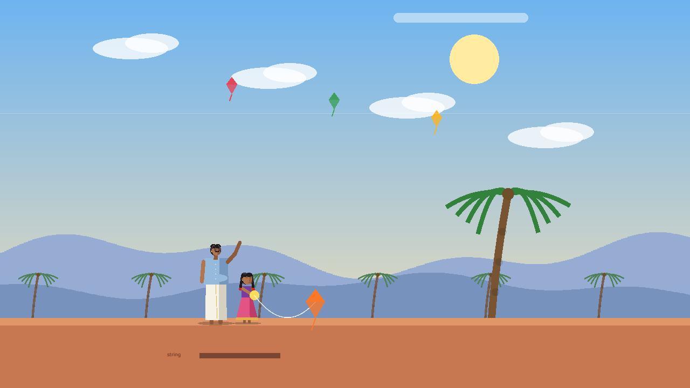

# கோலம் Kolam


A cozy story and puzzle game. Anu, a designer who likes her life in Hyderabad, goes home for Pongal and the temple festival. Shopping with Amma, old streets, old friends and her own childhood drawings bring back the little girl she was.

**Growing up doesn't mean leaving every part of your childhood behind.**

- What is a kolam: https://en.wikipedia.org/wiki/Kolam
- The math behind kolams: https://web.archive.org/web/20240911071012/https://www.cmi.ac.in/gift/kolam/kola_pattern.htm

| | | |
|---|---|---|
|  |  |  |
| *Home screen* | *Hyderabad, late at night* | *Home: colour comes back with each memory* |
|  |  |  |
| *Flashback: the kite, in full colour* | *Amma's notebook, the end of Chapter 1* | *A page of Amma's kolam book* |

## Play it

- **From a release build** (made with [`./release.sh`](#a-single-file-game-for-players)):
  - **Linux:** run `kolam-linux-x86_64`, a single file with nothing to install. Make it runnable first: `chmod +x kolam-linux-x86_64`.
  - **Windows:** run `kolam-windows-x86_64.exe`, a single file. If SmartScreen warns about an unknown app, choose *More info → Run anyway*.
  - **iPhone / iPad:** `kolam-ios.ipa` is unsigned, so it's installed with a sideloading tool that signs it with your Apple ID, no Mac needed: on Windows, [Sideloadly](https://sideloadly.io) or [AltStore](https://altstore.io) (iPhone connected by USB; you may need to turn on Developer Mode on the phone and trust your Apple ID in Settings → General → VPN & Device Management). With a free Apple ID the app opens for 7 days, then is installed again the same way; a paid Apple Developer account lasts a year.
  - **Android:** copy `kolam-android.apk` to the phone and open it. Allow "install unknown apps" for your file manager when asked. Or, with a USB cable: `adb install kolam-android.apk`. Tap where you'd click, and use the phone's Back button to pause.
- **From the source code:** see [Build and run](#build-and-run), then `./run.sh`.

## The story

**Anu Raghavan, 27**, designs apps for a Hyderabad startup, and she's good at it and likes it. She isn't running from the city, and home isn't a perfect place where everything is better: both are ordinary parts of her life. She just hasn't been home in a long time, and Amma's calls tend to arrive when she is busy.

One night Amma leaves a voice message: Pongal is coming, the temple festival preparations have started, and the house is quiet. Anu takes the night bus home to her village on the **Bhavani river, between Mettupalayam and Sathyamangalam** in western Tamil Nadu: the blue Nilgiri hills on one side, coconut groves and Sathyamangalam's jasmine fields on the other.

Over the days before the festival she shops with **Amma**, walks the old streets, meets a childhood friend, and finds Amma's kolam notebook and her own unfinished childhood drawing. **The temple festival** is the main event: it sets the timeline, the places, the puzzles and the big moments. **The kolam** is the thread through all of it, and the final kolam means something because the player has spent the game learning what it stands for.

**Colour and memories.** Colour shows how memories make familiar details noticeable again; it isn't a happiness meter. The present day is a little muted at first (never grey or gloomy), and each memory Anu finds brings colour back. Flashbacks and childhood imagination are always in full colour, and festival scenes are colourful anyway: lights, flowers, decorations.

**Work is not the enemy.** Work calls can interrupt, and the player can answer or say *Not now*. Neither choice changes the story or the colour.

**Few words.** Sounds, objects, animation and play tell the story. Conversations are everyday ones between a mother and daughter: no speeches, no one explaining how they feel. Hard lines (like Anu's *"Hi, Amma."*) only come out while the player holds the button.

**Memories are playable** where possible: rather than watching a flashback, you become little Anu for a moment (the kite now; the bicycle and others later).

The story is told **in order**, one chapter at a time. Each chapter starts with a title card. Any chapter can be played from **Chapters** (on the home screen and in the pause menu), even one you haven't reached yet.

### Chapter 1: Home (the demo)

Built first, as the demo and mock-up for playtesting: does the play carry the feeling? It runs **about 10 to 15 minutes**: Hyderabad lasts 20 seconds, the bus ride 25, the kite needs 7 seconds in the wind. Text types fast by default (Settings → Text speed). The timings are constants at the top of each scene (`BUSY_SECONDS`, `JOURNEY_SECONDS`, `KITE_GOAL_SECONDS` in `minigames.cpp`; `FIRST_CALL_SECONDS` in `explore_scene.cpp`).

| Step | What happens | How you play |
|---|---|---|
| **Title card** | *Chapter 1: Home. Hyderabad, eleven days before Pongal.* | It moves on by itself after 3.5 seconds. |
| **Hyderabad, 11:47 pm** | Anu at her desk, designing an app's screens. Messages from work (mostly nice ones) pile up, and Amma calls three times. | Work is clicking a card on the screen, which then wants to be somewhere else, again and again. Swipe messages away; each of Amma's calls leaves a small green missed-call mark. At midnight (or when you tap it), everything falls away except Amma's voice message. |
| **The voice message** | Amma's message plays on Anu's phone, its words under the waveform. | Listen. Then type the reply she always sends (each key or tap types more): *"busy ma, call u later"*. She deletes it. The bus ticket appears: **Book**. |
| **The night bus** | No words. The city turns to fields, night to dawn, past Mettupalayam and the Bhavani. | Drag across the window to wipe the fog. Kolam dots appear in the fog one by one, join into a kolam for a moment, and fade. Click the phone to turn it face down if you like. Click to get off at dawn. |
| **Home, by the Bhavani** | The front step, the hall, the kitchen and the terrace, and Amma. | Explore and click things. Memories flood the world with colour for a moment, then it settles a little brighter. Trace the pencil height marks on the doorframe (the last one is from when she was fifteen). Meeting Amma, *"Hi, Amma."* only comes out while you **hold**. Work calls: answer (a short, friendly call) or *Not now*. The kite reel ends the scene. |
| **The kite** | A memory: little Anu flying a kite with Appa on Pongal morning. | You are little Anu. Pull to climb, but too hard and it wobbles and dives; let go as a gust comes and it lifts. Keep it in the high wind for 7 seconds. |
| **The terrace, after** | Night. Back in the present, the reel in her hands. | A quiet moment, no words. |
| **Coffee for Amma** | Early morning, before Amma is up. No words. | Hold to pour the decoction, then the milk. Then stretch it: hold to pour from the tumbler into the davara, moving up and down. Too low doesn't mix, too high splashes, in between it froths. No score. |
| **Five in the morning** | Amma, at the door with the rice flour, can't bend down. Anu takes the flour. *"What?"* Anu nods at the doorstep. | |
| **Amma's list** | Amma's kolam notebook, open at the festival kolam, which draws itself. Not yet. Amma: *"Come tomorrow. We have a lot to buy."* Her shopping list; the last item has a little drawing of flowers. *Tomorrow.* | Click to go on. End of Chapter 1. |

The full doorstep kolam (free drawing with mirrors, Amma's pattern underneath, and its ending) has moved to Chapter 8. Its code (`DoorstepScene` in `scenes.cpp`, `Doorstep()` in `story.cpp`) is kept for it.

### Chapter 4: Amma's Book

Built next, straight after Chapter 1 (Chapters 2 and 3 come in between when they're written). A quiet afternoon at home with Amma's kolam book: each of Amma's pages is a puzzle, and each brings back a short memory in full colour.

| Step | What happens | How you play |
|---|---|---|
| **Title card** | *Chapter 4: Amma's Book. Home, seven days before Pongal.* | |
| **After lunch** | The hall. Amma is asleep. Anu sends her last file, shuts the laptop and sits on the swing, on something hard: Amma's kolam book. | Click to go on. |
| **Amma's four pages** | After each page, a memory: little Anu, six, watching Amma put down the dots before dawn (*"So the line knows where to go."*); Amma's hand around hers (*"Crooked is fine. Just don't lift."*); copying Amma's side of the step (*"Who used up all the flour?" "It's for the ants."*); and Amma writing in the book on festival eve (*"What are you writing?" "Nothing. Sleep."*). | Solve each page. The memories are in full colour, on the front step with Amma and little Anu (the festival-eve one in the hall at night), and each one brings a little colour back to the present day. |
| **In the margin** | What Amma wrote that night, beside the festival kolam. | |
| **MY KOLAM** | Little Anu's crayon page: *"amma says fix it"*. Anu fixes it. Amma is up: *"Finally."* | Solve it. |
| **the BIG one** | *"i will finish this one when i am big"*. Not yet: it is drawn in Chapter 8. | Look at it. Clicking between its dots only says *Not yet.* (`LookAt()` in `story.cpp`) |
| **When I'm big** | *"And that one?" "When I'm big."* Amma laughs. Then the harder thing to ask, and Amma's answer. That night, an alarm for 4:50 am. | Hold to say *"Amma. Wake me up at five?"* |

### Inspirations

Kolam is its own game, but it learns from these. It takes ideas, never their stories, characters or look:

| Game | What Kolam takes from it | Where |
|---|---|---|
| **Florence** | The way you play *is* the feeling. Wordless moments, and small actions that change as the person changes. | Work that never ends; typing the usual reply and deleting it; wiping the bus window; holding to get "Hi, Amma." out; tracing the height marks |
| **Venba** | Cooking as love and memory in a South Indian family, and a parent's way of doing things handed down | Filter coffee for Amma; Amma's kolam notebook; cooking pongal (Chapter 5) |
| **Fishbowl** | Growing up told through a phone and a home's everyday objects | The voice message on the phone; Amma's calls leaving marks; the calendar with "Anu?"; the names scratched on the vessels |
| **To the Moon** | Objects that hold memories, and an ending that lands quietly | Each memory blooms into full colour; the kite reel opens a memory; the kolam in the bus fog; the flower on the list |
| **Coffee Talk** | Slow, warm moments, and making a drink for someone as a way of listening | The coffee at dawn: a quiet scene with nothing to win |

### The whole game (planned)

The chapters follow the days before Pongal and the temple festival:

| Chapter | When | What happens | How you play it *(all built)* |
|---|---|---|---|
| **1. Home** | 11 days before | Hyderabad, the bus, the homecoming | Work card, voice message, fog, exploring (through the doors), kite, coffee |
| **2. The List** | 10 days before | Shopping with Amma at the market; the flower seller (*"You used to know exactly which flowers you wanted."*), the bangle stall. The last thing on the list can't be bought. | Tap stalls to fill the list into the bag; measure jasmine; reach for the kanakambaram; pin flowers in little Anu's plait; choose bangles one by one; shake them into rain; unpack at home |
| **3. Familiar Streets** | 9 days before | The old street and school; Meena (*"Do you still draw?" "Not really."*); the drawing book in the trunk | Walk the street as it flickers into memory; five stones; fold and steer a paper boat in the rain; explore home at night |
| **4. Amma's Book** | 7 days before | Amma's kolam notebook, her note in the margin, little Anu's pages; the BIG one, "not yet" | The kolam book puzzles, each followed by a memory on the doorstep |
| **5. Preparations** | 4 days before | Mango leaves, getting the house ready, Anu's first doorway kolam, the pongal pot | Hang the thoranam; hand Appa leaves up the ladder; explore; the doorway kolam; keep the pot rising until it boils over |
| **6. Festival Night** | Festival eve | The lit tower, the festival street with Meena, Amma lighting lamps (*"Still the same."*) | Light the last lamp; ring toss; spin the paper windmills; run with Appa; light the lamp row with Amma; turn the book's pages |
| **7. The Little Girl** | Festival eve, late | A crayon dream: little Anu and Anu finish the BIG one together | Colour the crayon world in; the BIG one; go over it once more; switch off the 4:50 alarm |
| **8. Five in the Morning** | Pongal morning | Amma holds the flour out; Anu draws the kolam; *"Mine never had a flower."*; the pots boil over | Take the flour; the doorstep kolam; fan the fire until the pongal boils over |
| **9. What We Carry** | After | The kolam on the step, then Hyderabad and a flower on a sticky note; Anu calls first | Pack the tiffin and the flour; work; draw the flower; call Amma |

Each chapter's scenes are in their own file (`ch2_list.cpp`, `ch3_streets.cpp`, `ch5_preparations.cpp`, `ch6_festival.cpp`, `ch7_dream.cpp`, `ch8_morning.cpp`, `ch9_carry.cpp`, with shared helpers in `lp_common.h`, `streets_kit.*` and `finale.h`). The build order was the same: Chapter 1 first, then shopping, the streets and scrapbook, the notebook and preparations, the festival, and the crayon world with the finale. No combat, lives, hard timers or platforming; shopping and festival games should be fun, never chores.

## The game

A cozy story game made with [raylib](https://www.raylib.com/) in C++.

- **Explore** Anu's home: the front step, the hall, the kitchen and the terrace. Click things to remember them. Each memory comes back as a *pulli* (a kolam dot) at the top of the screen, and the world gets more colourful.
- **The phone** rings while you explore: work. Answer for a short, friendly call, or *Not now*. Neither changes anything.
- **Flashbacks** you play as little Anu, like flying a kite with Appa on a Pongal morning nineteen years ago.
- **Amma's kolam book.** Each page is a *sikku kolam* puzzle: one line has to loop around every dot without touching it. Each page is played one of two ways, fixed per page (`draw` in `Pages()`, story.cpp):
  - **Walls** (pages 1 and 2, the simplest): click between two dots to put up a wall, and the line bounces off it. Join every separate line into one.
  - **Drawing** (pages 3–7): hold the button and drag to draw the line yourself. It flows after your finger (or the mouse) from gap to gap, hurrying to catch up with a quick one, and always comes out as clean kolam curves round the dots. However fast you go, it follows the way your finger actually went, in order, even where the line crosses itself. Amma's ink decides the way at most gaps; at the rest the line goes whichever way you lead it. **Undo** takes the line back to just before the last way you chose; **Erase** (next to **Draw**) lets you swipe over the line to cut it back to there; **Start over** clears the page. Amma's finished kolam lies open beside the page to copy from (on a square screen, small in the page's bottom-right corner). The page is done when the line closes round every dot, which only Amma's kolam does.

  Either way, the finished kolam then draws itself in a single stroke.
- **Little Anu's pages** in the same book are on school-notebook paper in crayon, and the last one is the kolam she promised to finish "when I am big". In Chapter 4 it stays unfinished.
- **The night bus**: no words, just the window, the fog, a kolam in the fog, and the phone.
- **Coffee for Amma**, and **Amma's list**, which ends Chapter 1.
- **The doorstep kolam** at dawn (built; it waits for Chapter 8).
- **Home screen** with Continue, New Game, Chapters, Mechanics, Settings and Exit. On a wide screen (a phone held sideways, or a 16:9 window) the title and menu sit on the left and the kolam draws itself on the right; on a narrower screen they're stacked in the middle. Phones fill their whole screen by default (Settings → Screen shape). Progress, including the memories you've found, saves automatically.
- **Chapters** lists every chapter with where and when it happens, and plays any of them from its title card, reached or not, even on a new game. A small dot marks the ones you've played before. It is also in the pause menu, to switch chapters mid-game. Starting a chapter saves the game there, so Continue carries on from it.
- **Mechanics** shows the main mechanic on its own: every page of Amma's kolam book as a card, all open from the start, with no story around them. Solving a page draws the kolam in one stroke, then goes back to the cards with a tick on that one (until the game closes) and the next page picked. **Esc** on a page puts it back.
- **Other kolams**, the second row on the Mechanics page (under the kolam book's seven pages), has a small game for each other kind of kolam. Each is drawn in rice flour on the doorstep floor, with Amma's note (her drawing and a line in her hand) pinned in the top-right corner. Her note is only for inspiration: press **Done** whenever you like your kolam.
  - **Pulli:** drag from dot to dot for straight lines; each is copied to all eight matching places, so stars and diamonds come easily. Undo, and an eraser, for mistakes.
  - **Padi:** drag along the grid to step out from the square in the middle; pick *kaavi* (red earth) for the border. Undo and an eraser too.
  - **Poo:** pick a colour and paint flower petals into the flower's shapes.
  - **Lotus:** drag out from the middle for a ring of petals; tap a ring (or the middle) to colour it.
  - **Freehand:** draw anything; *Mirror* copies it eight times round the middle. Undo takes back the last line; the eraser wipes bits away.
- **The pointer** is a plain white arrow, and a pointing hand over anything that can be clicked. Both are [Phosphor Icons](https://phosphoricons.com) (MIT licence, `assets/cursors/LICENSE.txt`), recoloured in `art/cursors/*.svg` and turned into the PNGs in `assets/cursors/`.
- **Settings:** volume and music (sliders: tap or drag), text speed, **text size** (Normal, Large or Larger: every word in the game gets bigger; phones start at Large), windowed or fullscreen (computers only), screen shape and screen edges. Each choice has < > arrows; tapping the row itself picks the next one. Open it from the home screen, or from the pause menu while playing.
- **Any screen size or shape:** the game is 16:9 by default. Settings → Screen shape switches to *Fill screen* (as wide as your window or phone), *4:3* or *Square*. It stays sharp at any size, from a small window to a 4K monitor or a phone. If the window's shape doesn't match, the space beside the game is filled with a soft glow of the scene or with black bars (Settings → Screen edges).

## How to play

| Where | Controls |
|---|---|
| Menus | Mouse, or **Up/Down** and **Enter**. **Left/Right** changes a setting. **Esc** goes back. A long list (Chapters) scrolls with **Up/Down**, the **mouse wheel** or its arrows. |
| Story | **Click**, **Space** or **Enter**: show the whole line, then go to the next one |
| Hyderabad | **Click** the card on the screen to work and **click** messages to clear them. Or tap Amma's voice message and stop. |
| Voice message | **Any key or click** types the reply. **Click** *Book*. |
| Hard lines | When a ring pulses in the dialogue box, **hold** the mouse button (or Space) to say the line. |
| Coffee | **Hold** to pour. When stretching, **move the mouse up and down** to pour from higher or lower, and **let go** to pour it back. |
| Night bus | **Drag** across the window to wipe the fog. **Click** the phone to turn it over. At dawn, **click** to get off. |
| Exploring | **Click** things to look at them. **Click** a door, doorway or the stairs to walk through. In the hall the front door is on the left wall (on narrower screens, such as 4:3 or square, it's at the bottom of the picture, behind you); in the kitchen and on the terrace the way back is at the bottom, behind you. A small dot on a door means something that way is still waiting for you. On the doorframe, **drag up** to trace the height marks. |
| The kite | **Hold** the mouse button (or **Space** / **Up**) to pull, **let go** to give slack, **move** the mouse (or **Left** / **Right**) to steer. Let go as a gust comes to lift it. Keep it in the strong wind. |
| Amma's list | **Click** to go on. |
| Kolam book | Wall pages: **click** between two dots to add or remove a wall. Drawing pages: **hold and drag** to draw the line; **Undo** and **Erase** take it back. **R** (or Start over) starts the page over. |
| Doorstep | **Drag** to draw (don't touch the dots). **H** / **V** toggle the mirrors, **Z** undoes, **C** clears, **Enter** finishes. |
| Anywhere | **Esc** (or the pause button in the top-left corner) pauses: Resume, Save game, Chapters, Settings, Main menu. In a game from the Mechanics page the pause menu is Resume, Settings, Back to the kolams, Main menu. **F11** toggles fullscreen. |

On **Android**, tap where you'd click, hold where you'd hold and drag where you'd drag. Everything has a touch control:
- **Pause:** while playing (the story, or a game from Mechanics), a round button in the top-left corner opens the pause menu, with Settings and a way back.
- **How to play:** the **(i)** button beside it (and *How to play* in the pause menu) shows every gesture as a little animated hand: tap, swipe, hold, drag, erase.
- **Talking:** a tap shows the whole line; a **swipe** goes on to the next one, so a stray tap never skips a line before it's read (with a mouse or keys, a click goes on as before).
- **First-time hints and nudges:** the first few times a gesture is needed (holding to say a hard line, swiping, drawing a kolam line) an animated hand shows it. After that, hints rest until the player seems stuck: about 10 seconds with nothing happening in the house and the next thing to look at glows (or the door towards it); on a kolam book page the right way at the next turn glows in gold, or the spot to change on a wall page, or Undo when an earlier turn went wrong. While drawing, both ways at a coming turn show faintly, so the turn can be seen under a fingertip. The phone's **Back** button does the same, goes back from every menu, and on the home screen closes the game.
- **Start over** is a button at the top right of every kolam book page (R on a keyboard). The doorstep drawing has **Draw / Erase**, **Mirror**, **Undo**, **Clear** and **Finish** buttons (H/V, Z, C and Enter on a keyboard).
- **Rubbing out:** every game where you draw lines (Pour the Line pages, Pulli, Padi, Freehand, the doorstep) has the same two ways. **Undo** takes back the last thing drawn (tap again for more). **Draw / Erase** switches to the eraser: swipe over lines and just what your finger passes over is wiped away (on a Pour the Line page, the line is cut back to there). What goes fades out.
- The words on screen say *Tap* instead of *Click*, and there's no mouse pointer. The game fills the phone's screen, edge to edge: it draws beside the camera notch and under the see-through navigation buttons (`android/res/values*/styles.xml`). The home screen puts the menu on the left and the kolam on the right.

## Build and run

The game is built with [xmake](https://xmake.io) (Arch: `pacman -S xmake`; others: see [installing xmake](https://xmake.io/#/guide/installation)) and a C++ compiler. xmake gets [raylib](https://www.raylib.com/) by itself: it uses the one installed on your system if there is one, otherwise it downloads and builds it on the first run.

```bash
./run.sh                          # build (only what changed) and run the game
./run.sh --dev                    # developer mode: rebuilds and reopens when you save a file (see below)
xmake                             # just build -> build/linux/kolam (or build/<your system>/)
xmake run kolam                   # run it
xmake run kolam --check-pages     # check that every puzzle page is solvable
xmake f -m debug                  # switch to debug builds: raylib logs on, N solves a puzzle page
xmake f -m release                # back to normal builds
xmake clean                       # delete what was built
```
All the build settings are in `xmake.lua`, in one short file with comments.

#### Developer mode: see changes as you save

```bash
./run.sh --dev
```
The game opens as usual. Then, whenever you **save a file in `src/` or `assets/`** (code, story, art), or press **F5** in the game:
1. the game saves and closes,
2. only what changed is rebuilt (a few seconds),
3. it opens again **right where you were**: the same scene, with the memories you'd found. The intro is skipped.

If the code doesn't compile (or the game crashes), the errors stay in the terminal; fix them and save, and it carries on. Close the game window to stop. A small "DEV" note in the corner shows when developer mode is on; players never see it.

This restarts the game rather than swapping code while it runs. Swapping C++ code in a running game is possible, but fragile and complicated, while a restart into the same scene is quick and always reliable.

### A single-file game for players

```bash
./release.sh                   # every platform listed in PLATFORMS at the top of release.sh
./release.sh android           # just Android
./release.sh linux windows     # just these two
```
To change what a plain `./release.sh` builds, edit the `PLATFORMS="linux windows android"` line at the top of `release.sh`.

| Platform | You get (in `build/release/`) | Runs on |
|---|---|---|
| `linux` | `kolam-linux-x86_64`, one single file | Most Linux systems: glibc 2.31 or newer (Ubuntu 20.04+, Debian 11+, Fedora, Arch...) |
| `windows` | `kolam-windows-x86_64.exe`, one single file | Windows 10 and 11, with no DLLs or installer |
| `android` | `kolam-android.apk` | Android 7.0 and newer, 64-bit ARM phones (nearly all phones since 2017) |
| `ios` | `kolam-ios.ipa`, unsigned | iPhone and iPad, iOS 13 and newer. Only builds on a Mac with Xcode: without one, GitHub builds it (below) |

Everything (fonts, music, images) is inside each of them. Saves and settings go in the player's home folder (on Android, the app's private storage).

**How it works:** `release.sh` is only xmake commands, one build per platform. Everything else is in `xmake.lua`:
- **Linux and Windows** are built with [Zig](https://ziglang.org/), a C/C++ compiler that can build for other systems. xmake downloads it, and builds raylib with it.
- **Linux** uses `--portable=y`, which targets an older glibc so the game runs on older Linux too.
- **Android** uses xmake's `android.native_app` rule to make and sign the APK.
- **Each platform keeps its own xmake settings**, so a release never changes your everyday `xmake` setup.

**What you need:** `xmake`, and the X11 headers for Linux (already on most Linux desktops). For Android you also need the Android SDK and NDK, set up once as shown below. No sudo, no Docker.

**How long it takes:** the first release downloads Zig and builds raylib for each platform, which takes a few minutes. After that, a release takes seconds, because only the game itself is recompiled.

#### One-time Android setup

`release.sh` looks for Android's SDK in `~/Android/Sdk`, where Android Studio puts it (or set `ANDROID_HOME`). If you don't have Android Studio, install just the parts the game needs (about 1.5 GB). This needs Java (JDK 17 or newer) and asks you to accept Google's licenses:
```bash
curl -LO https://dl.google.com/android/repository/commandlinetools-linux-11076708_latest.zip
mkdir -p ~/Android/Sdk/cmdline-tools && unzip -q commandlinetools-linux-*_latest.zip -d ~/Android/Sdk/cmdline-tools
mv ~/Android/Sdk/cmdline-tools/cmdline-tools ~/Android/Sdk/cmdline-tools/latest
~/Android/Sdk/cmdline-tools/latest/bin/sdkmanager --licenses
~/Android/Sdk/cmdline-tools/latest/bin/sdkmanager "ndk;27.2.12479018" "build-tools;34.0.0" "platforms;android-34"
```

**Android files** are in `android/`:
- `AndroidManifest.xml` sets the app's name, icon, screen orientation and package name (`com.kolam.game`).
- `res/drawable/icon.png` is the app icon.
- `debug.keystore` is the key the APK is signed with (password `android`). **Keep it:** phones only accept an update to the app if it's signed with the same key. For the Play Store you'd make a proper release key instead.

Every push is built on GitHub (`.github/workflows/build.yml`), which runs `./release.sh linux`, checks the puzzle pages, and attaches the Linux game to the run. A second job builds the iPhone game on one of GitHub's Macs (`./release.sh ios`) and attaches `kolam-ios.ipa`: open the run on GitHub (Actions tab) and download **kolam-ios** under *Artifacts*.

**How the iPhone build works.** raylib has no iOS layer of its own, so on iPhone it runs on [SDL](https://libsdl.org)'s, drawing with OpenGL ES 2 (the `raylib-sdl` package in `xmake.lua`; raylib's sound is built as Objective-C there, as iOS needs). The app's description (name, landscape, fullscreen) is `ios/Info.plist`. In the game's code, iPhone and Android are both "phones" (`PLATFORM_PHONE` in `game.h`): touch, no pointer, always fullscreen.

## Working on the game

```
kolam/
├── xmake.lua     how to build (see above)
├── run.sh        builds and runs the game
├── release.sh    builds the finished games for Linux, Windows and Android
├── src/          the code: start with game.h
├── assets/       fonts, music, sounds, the intro gif: built into the game when it compiles
├── android/      the Android app's manifest, icon and signing key
├── art/          design sources (posters, Krita files, screenshots); not used by the game
└── build/        made by xmake, never edit or commit (xmake also keeps notes in .xmake/)
```

All the code is in `src/`. Start with `game.h`: it declares everything and says which file does what.

| File | What it does |
|---|---|
| `story.cpp` | **All the content**: dialogue, puzzle pages and the order they come in. Writers only need this file. |
| `main.cpp` | Window, main loop, every screen (home, chapters, pause, playing), and the screen shader that turns the world grey or colourful |
| `settings_screen.cpp` | The Settings screen: sliders and < > choices, for touch, mouse and keys |
| `art.cpp` | The people (Amma, Anu, little Anu, Appa) and shared scenery (hills, palms, jasmine, brass pots, tiled floors, soft shadows), drawn with shapes until the real art arrives |
| `scenes.cpp` | Intro animation, chapter title cards, dialogue scenes, Amma's list (the end of Chapter 1), and the doorstep drawing (for Chapter 8) |
| `explore_scene.cpp` | Walking around the house: the rooms (drawn with shapes for now), what's clickable where, memories, the doorframe close-up, the phone |
| `minigames.cpp` | Hyderabad, the voice message, the night bus, the kite, and filter coffee |
| `puzzle_scene.cpp` | A page of the kolam book |
| `mechanics.cpp` | The Mechanics page: every game as a card on one page (the kolam book's pages, then the other kolams), to play outside the story |
| `kolam_kinds.cpp` | The other kinds of kolam (pulli, padi, poo, lotus, freehand), each a small game with Amma's note |
| `cursor.cpp` | The mouse pointer: an arrow, or a hand over clickable things (scenes call `PointAtSomething()`) |
| `kolam.cpp` | The puzzle rules and how kolam lines are drawn |
| `ui.cpp` | Fonts, menu buttons, text helpers, the home screen animation |
| `audio.cpp` | Sounds: each place's background sound (fading from one to the next), effects, and loops like pouring |
| `save.cpp` | Settings, save-game files, and the memories Anu has found (`Progress`) |
| `game.h` | Shared declarations and colors |

### Drawing art for the game

The game's look is meant to be **hand-drawn**: each story moment is an illustrated scene with one small interaction. Until a scene's art exists, it's drawn with shapes in code, so the game is always playable. The stand-in art is made to look drawn too:
- **`art.cpp`** has the people, shaded with the light from the upper left, and scenery pieces the places share. Use them rather than plain rectangles: `DrawPalm()`, `DrawHills()`, `DrawJasmine()`, `DrawPot()`, `DrawTiledFloor()`, `DrawSoftShadow()`.
- **The setting:** a village on the Bhavani between Mettupalayam and Sathyamangalam. That means blue Nilgiri hills, coconut groves, jasmine, a lime-washed house with a clay-tiled roof and a thinnai, and a red oxide floor inside.

When you draw a scene:
- **Canvas:** 1920×1080 pixels (16:9). That's 1.5 pixels per game unit, so the stage, the centred 720×720 square, is the middle 1080×1080 pixels. Keep anything important (characters, things to click) inside the middle 1440×1080 (4:3); the outer edges can be cropped when the screen shape is 4:3 or square.
- **Layers:** export each layer as its own PNG **at the full 1920×1080 size**, transparent everywhere except what's drawn on it. Each layer then lands exactly where you drew it, so the game needs no position numbers. Typical layers: `background`, the people (`amma`), each thing that can be clicked (`grinding_stone`), anything that moves (`steam`), and a `foreground`.
- **Where:** `assets/scenes/<scene name>/<layer name>.png`, e.g. `assets/scenes/kitchen/amma.png`. Everything in `assets/` is built into the game automatically.
- **Krita:** keep the `.kra` source files in `art/`, and export PNGs from there.

The code to show these layers comes next, as the first scenes are drawn.

### Sounds

Every sound is an `.ogg` file in `assets/sounds/`, used by its name (without `.ogg`). Three calls, all in `audio.cpp`:
```cpp
PlayAmbience("crickets", 0.5f);   // the place's background sound, looping; the old one fades out
PlayEffect("click");               // once
PlayLoop("pour");                  // keeps going while it's called every frame
```
Scenes call `PlayAmbience()` in their `Update()`, so a place always has its sound, even after loading a save. Menus are quiet, and the song plays softer while a place has its own sound. Every button already clicks (`Clicked()` in `ui.cpp`).

| Sound | Where |
|---|---|
| `city_night` | Hyderabad and the voice message |
| `bus` | The night bus |
| `birds_day` | Home by day (softer indoors); daytime scenes |
| `crowd` | The terrace: the festival far off |
| `crickets` | Night scenes |
| `morning` | Coffee, Amma's list, the doorstep |
| `wind`, `gust` | The kite (letting go into a gust whooshes) |
| `notify`, `vibrate` | Work messages; Amma's calls and work calls |
| `click`, `page`, `scribble`, `pencil` | Buttons and typing; the notebook and kolam book; walls in the kolam book; tracing and drawing |
| `pour` | Pouring coffee (louder from higher) |
| `bell`, `temple_bells` | A memory coming back; the temple tower |

To add one: find a sound you're allowed to use (CC0 is easiest), make it a small mono `.ogg` (e.g. `ffmpeg -i in.wav -ac 1 -c:a libvorbis -q:a 2 assets/sounds/name.ogg`), and add it to [Credits](#credits).

### Add or change dialogue

The story is `Chapters()` at the bottom of `story.cpp`: a list of chapters, each a list of steps played in order. An empty speaker means narration:
```cpp
{"home", "Chapter 1", "Home", "Hyderabad, eleven days before Pongal", {   // id, heading, title, where
    Busy(),
    VoiceMessage("Amma's voice message", {   // played on Anu's phone
        {"Amma", "Kanna. It's Amma."},
        {"Amma", "Pongal is on the fourteenth."},
    }),
    Travel(),
    Talk("Home", {
        {"Amma", "Anu..."},
        {"Anu", "Hi, Amma.", 2.5f},   // hard to say: hold the button 2.5 s for the words to come out
    }),
    Talk("Five in the morning", {
        {"Amma", "What?"},
    }).At("front_step", NIGHT),   // shown over a place: front_step, hall, kitchen, terrace
    Talk("The terrace, after", {}).At("terrace", NIGHT),   // no words: a quiet moment there
    Memory("...", {...}),      // a flashback: same as Talk, but in full colour;
                               // its label is a memory Anu gets back (brings colour back)
    Memory("...", {...}).At("front_step", NIGHT).WithAmma(),  // ...with little Anu and Amma there
    Puzzle(2),                 // page 3 of the kolam book
    LookAt(5),                 // page 6, only looked at: it waits for a later chapter
    AmmasList(3, {{"Amma", "Come tomorrow."}, {"", "Banana leaves"}, {"", "Flowers"}}),
                               // her notebook at page 4's kolam, what she says, then the list
    Kite(),  Coffee(),  Doorstep(),   // the other minigames
}},
```
- **Keep it short.** If the picture can say it, cut the line.
- **A new chapter** is one more `{id, heading, title, where, {steps}}` in the list. The `id` is never shown, but saves and the Chapters menu remember chapters by it, so don't change it once players have saves.
- The save game remembers the chapter and the step number in it, so **add steps at the end of a chapter rather than in the middle**. Otherwise existing saves resume in the wrong place.
- Reached chapters are kept in `chapters.txt` (next to the saves), with the memories Anu had found by then, so replaying one starts with the right amount of colour. A chapter played before it was reached starts with every memory from the chapters before it (`ProgressAtChapterStart()` in `save.cpp`).

### Add things to explore

An `Explore` step lists what can be clicked, and what happens when it is:
```cpp
Explore("Home", false /* night? */, {
    {"swing", "The swing", {                 // object, the name shown on hover, then the lines
        {"", "It creaks the same way."},
    }, "The swing"},                         // the memory Anu gets back (brings colour back)
    {"kite_reel", "Appa's kite reel", {...}, "", true},   // true = clicking this moves the story on
}),
```
*Where* each object sits is in `ROOM_OBJECTS` at the top of `explore_scene.cpp`, with each room's drawing just below it. To add a new object, give it a name and a rectangle there, draw it in its room, then use the name in `story.cpp`. How the rooms connect is in `DOORS`, just below it: each door's room, where it leads, its name and its rectangle (never on top of an object's). A door can be marked `WIDE_SCREENS` or `NARROW_SCREENS`: the hall's front door is left of the 720×720 stage, so narrower screens use the threshold at the bottom instead.

### Add a puzzle page

Pages are in `Pages()` in `story.cpp`. A page is drawn as text, one character per point:

```
"+.+.+.+",      o  a dot            +  a corner (ignored)
".o#o.o.",      #  wall in ink      .  gap in ink         (the player can't change these)
"+.+.+?+",      ?  a gap the player can turn into a wall
".o#o#o.",      *  a wall the player can turn into a gap
"+.+.+.+",
".o.o.o.",      The outer border is ignored and always acts as a wall.
"+.+.+.+",
```

The kolam line runs diagonally between the dots. It crosses straight through gaps and bounces off walls. A page is solved when it becomes **one** line. Rules of thumb:
- Lock most of the page in ink (`#` and `.`) and leave a few `?` spots for the player.
- A symmetric page (every change is mirrored to all four corners) needs an **odd** number of dots across and down, because an even-sized symmetric kolam can never be one line.

Then check every page is solvable and doesn't start already solved:
```bash
./run.sh --check-pages
```

### Testing without a window

The game can play itself from a script and save screenshots, without opening a window on your desktop (`src/autotest.cpp`):
```bash
# a test save: resume Chapter 1 at step 3 (exploring home)
mkdir -p /tmp/kolam-test/kolam
printf 'chapter=home\nstep=3\nprogress=|0|0\nsaved_at=0\n' > /tmp/kolam-test/kolam/savegame.txt

XDG_DATA_HOME=/tmp/kolam-test ./build/linux/kolam --dev --resume --hidden \
    --click 640,400@4 --shot /tmp/hall.png@5.5
```
- `--hidden`: no window (it still draws). `--shot FILE@T`: save the screen at T seconds; the game closes after the last one.
- `--click X,Y@T`, `--hold X,Y@T+D` (let go D seconds later), `--drag X1,Y1:X2,Y2@T+D` (more points make a path), `--size WxH` (the window's size, e.g. `1600x720` for a phone), `--touch` (play as on a phone: *Tap* wording, no pointer), `--key NAME@T` (space, enter, escape, the arrows, f5, or a letter).
- X and Y are pixels of the 1280×720 window, where the stage starts at x = 280. `XDG_DATA_HOME` keeps the test's save away from your real one.

### Good to know

- **The stage and the screen:**
  - The screen is 720 units tall and as wide as the chosen shape: 1280 for 16:9, 960 for 4:3, 720 for square.
  - Everything is positioned on the **stage**, the 720×720 square in the middle, from (0, 0) to (720, 720), so menus, dialogue and puzzles stay centred on any shape.
  - `FullScreen()` is the whole screen in the same units (its left edge is negative on wide screens). Use it, or `DrawBand()` / `DrawBandGradient()`, for backgrounds, so they reach the edges. Anything that belongs in a screen corner (like the memory dots) uses `FullScreen().x`.
  - The mouse always reports stage units, so scenes never need to know the window's size.
  - `main.cpp` draws each frame at the window's real resolution (a `Camera2D` zooms the units up), and the fonts are made to match (`LoadFonts()` in `ui.cpp`). Nothing is stretched after drawing, which keeps text sharp.
- **Esc belongs to the pause menu:** scenes shouldn't use it.
- **New `.cpp` files** in `src/` are picked up by xmake automatically.
- **New assets** go in `assets/`. xmake builds every file there into the game (the `embed_assets` rule in `xmake.lua`), so the finished game is one single file. Load them from memory with `FindAsset("assets/...")` and raylib's `Load...FromMemory` functions (see `LoadFonts()` in `ui.cpp`).
- **Colour:** every scene has a `colour` from 0 (grey) to 1 (full colour), and `main.cpp` runs the whole screen through a small shader that mixes in grey to match. Present-day scenes use `WorldColour()` (in `save.cpp`), which starts a little muted and rises with each memory found (`AddMemory()`): objects clicked while exploring, the kite, and every `Memory(...)` flashback once it has played. Work calls don't change it. Flashbacks use 1.
- **New kind of scene:** subclass `Scene` (in `game.h`). Load things in the constructor, free them in the destructor, and set `done = true` when it's finished. Put it in its own file (one per chapter, e.g. `ch6_festival.cpp`), register it by name with `PLAY_SCENE("ring_toss", MakeRingToss)`, and use it in `story.cpp` as `Play("ring_toss", "Ring toss")`. Nothing else needs changing. A `Play` step marked as a memory gives Anu that memory (by its label) when it ends. `./run.sh --check-pages` reports a `Play` name that doesn't exist.
- **Pictures and play, not reading:** every story beat should be an illustrated place with something to do. `--check-pages` prints a `(note)` for any dialogue step with no picture behind it.
- **Shared helpers** for scenes are in `ui.cpp`: `ContinuePressed()` / `BackPressed()` for input, `Clicked()` / `DrawButton()` for buttons, `AdvanceDialogue()` / `DrawDialogueBox()` for dialogue, and `Between()` / `Faded()` for fading things in and out. Use them rather than writing your own, so every scene behaves the same.
- **Formatting:** run `clang-format -i src/*.cpp src/*.h` before committing.
- **Where saves and settings go:**
  - Linux: `~/.local/share/kolam/`
  - Windows: `%APPDATA%/Kolam/`
  - macOS: `~/Library/Application Support/Kolam/`
  - Android: the app's private storage.

## Credits

- Akielsh - Developed
- Nithis - Developed
- Fonts: [Baloo Thambi 2](https://fonts.google.com/specimen/Baloo+Thambi+2) by Ek Type and [Kalam](https://fonts.google.com/specimen/Kalam) by Indian Type Foundry, both under the SIL Open Font License (see `assets/fonts/`)
- Made with [raylib](https://www.raylib.com/)
- Sounds, all [CC0](https://creativecommons.org/publicdomain/zero/1.0/) from [Freesound](https://freesound.org), trimmed and made quieter or louder to fit:
  - `city_night`: [DELHI ATMO busy city at night from far distance](https://freesound.org/s/509932/) by SoundEnsemble
  - `bus`: [bus_interior_highway](https://freesound.org/s/264409/) by ivolipa
  - `birds_day`: [North India Countryside Birds chirping](https://freesound.org/s/690626/) by Audiobaaz911
  - `morning`: [Morning In Palyem (North Goa, India)](https://freesound.org/s/272176/) by venaportae
  - `crickets`: [Night cricket ambience](https://freesound.org/s/130412/) by Abinash87
  - `crowd`: [India outdoor crowd](https://freesound.org/s/423510/) by Martin.Sadoux
  - `temple_bells`: [Indian Temple Bell](https://freesound.org/s/466652/) by ganiket
  - `bell`: [temple_bell_002](https://freesound.org/s/668647/) by tec_studio
  - `wind`: [breeze](https://freesound.org/s/181801/) by keweldog
  - `gust`: [Wind Gust](https://freesound.org/s/146932/) by crashoverride6
  - `notify`: [Notification Sound](https://freesound.org/s/235911/) by yfjesse
  - `vibrate`: [Phone vibration](https://freesound.org/s/515295/) by Breviceps
  - `click`: [Normal click](https://freesound.org/s/448086/) by Breviceps
  - `pour`: [Serving Water Slowly](https://freesound.org/s/241880/) by rafael45
  - `pencil`, `scribble`: [Drawing with a pen](https://freesound.org/s/407405/) by florianreichelt
  - `page`: [Page Turn](https://freesound.org/s/136778/) by davidbain

### Links

- YouTube Gameplay: _coming soon_
- itch.io Release: _coming soon_

## License

This project's sources are licensed under an unmodified zlib/libpng license, which is an OSI-certified, BSD-like license that allows static linking with closed source software. See [LICENSE](LICENSE) for details. The fonts keep their own SIL Open Font License.
